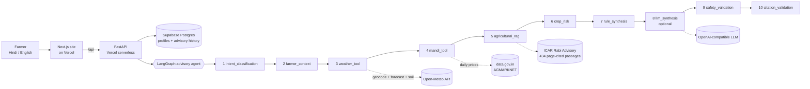

# KrishiMitra AI

**Live app:** https://krishimitra-ai-rho.vercel.app · **API:** https://krishimitra-api-five.vercel.app/docs

A bilingual (Hindi/English) crop advisory agent for small wheat and paddy farmers in Bihar. A farmer asks a question in plain Hindi, e.g. "मेरे गेहूं में कल सिंचाई करूं?", and gets an answer built from:

- **Live weather and soil moisture** for their district (Open-Meteo forecast and soil model; no key needed)
- **Today's mandi prices** from AGMARKNET via the Government of India Open Data API (data.gov.in)
- **Their crop's age**, worked out from the sowing date, matched to ICAR's critical irrigation stages
- **Page-cited ICAR guidance** from the *ICAR Rabi Agro-Advisory for Farmers 2021-22*, checked against the index before it is shown

Track: *Climate, Resource Infrastructure & Global Supply Resilience*, problem 1: Multilingual Agritech & Resource Advisory Assistant.

## Architecture



Each node is wrapped so a failing tool is recorded (`steps`, `errors`) and the remaining nodes adapt instead of the request crashing. The website shows every step, its result and its timing under "How the agent answered".

| Module | What it does |
|---|---|
| `backend/app/weather.py` | Geocodes the district, fetches the live forecast and soil moisture, retries on 429/5xx, caches for 15 min, serves the last real forecast (labelled stale) during outages |
| `backend/app/mandi.py` | Fetches today's AGMARKNET prices for Bihar, filters by crop, puts the farmer's own district first |
| `backend/app/knowledge.py` | Retrieves ICAR passages (term overlap + irrigation-topic + state relevance, filters out other states' passages) and validates every citation against the index |
| `backend/app/advisor.py` | Risk rules (rain, heavy rain, heat, frost, wind/lodging, dry soil, waterlogging), the wheat critical-stage calendar, intent detection, and the bilingual answer writer |
| `backend/app/agent.py` | The compiled LangGraph, failure isolation, and the optional LLM step |
| `backend/app/main.py` | API routes, input validation, the LLM dosage guardrail, and serving the website |
| `frontend/app/page.tsx` | The bilingual web app |

### Guardrails

- **No invented data.** If weather is down the answer says so and gives no forecast numbers. If there is no mandi key or no market reported today, the app says so instead of showing a price.
- **Citation check.** Each ICAR passage shown must match the index exactly (title, URL, page, text).
- **LLM safety.** The optional LLM only gets the live facts and the cited passages. Any pesticide or fertiliser dose in its answer that is not in a cited passage makes the app reject it and keep the rule-based answer.
- **Input validation.** Unknown districts, future or very old sowing dates, unsupported crops and empty questions get clear messages.

## Run locally

Backend (Python 3.10+):

```bash
cd backend
python -m venv .venv && source .venv/bin/activate   # Windows: .venv\Scripts\Activate.ps1
pip install -r requirements-dev.txt
uvicorn app.main:app --port 8765
```

Frontend (Node 18+), in a second terminal:

```bash
cd frontend
npm install
NEXT_PUBLIC_API_URL=http://localhost:8765 npm run dev    # Windows PowerShell: $env:NEXT_PUBLIC_API_URL="http://localhost:8765"; npm run dev
```

Open http://localhost:3000. API docs: http://localhost:8765/docs.

**Single server instead:** run `npm run build` in `frontend`, then start the backend. It serves the site at http://localhost:8765.

**Docker:** `docker build -t krishimitra . && docker run -p 7860:7860 -e DATA_GOV_IN_API_KEY=... krishimitra`, then open http://localhost:7860.

## Deploy

**Vercel + Supabase (the live deployment):**

1. **Supabase (database):** create a project, then *Connect → Transaction pooler* and copy the URI (port 6543). Tables are created automatically on first request.
2. **Vercel, API project:** *Add New → Project*, import this repo, set **Root Directory = `backend`**, add env vars `DATABASE_URL` (the Supabase URI exactly as shown, with `[YOUR-PASSWORD]` left in), `DATABASE_PASSWORD`, `DATA_GOV_IN_API_KEY`, optional LLM keys. Deploy. Check `https://<api>.vercel.app/api/health`.
3. **Vercel, website project:** import the same repo again, **Root Directory = `frontend`**, env var `NEXT_PUBLIC_API_URL = https://<api>.vercel.app`. Deploy.
4. If the website's URL does not start with `krishimitra`, add it to the API project's `CORS_ORIGINS` and redeploy the API.

**One container instead (Hugging Face Spaces, Render, Docker):** the `Dockerfile` builds the site and serves it with the API on one port. On Hugging Face, create a Docker Space and push this repo; on Render use *New → Blueprint* with `render.yaml`.

## Configuration

| Variable | Needed for | Where to get it |
|---|---|---|
| `DATA_GOV_IN_API_KEY` | Mandi prices | Free: sign in at https://data.gov.in → *My Account* → API key |
| `OPENAI_API_KEY` | Optional LLM answer | Any OpenAI-compatible provider |
| `OPENAI_BASE_URL` | Optional, non-OpenAI providers | e.g. `https://api.groq.com/openai/v1` |
| `OPENAI_MODEL` | Optional | Defaults to `gpt-4o-mini` |
| `DATABASE_PASSWORD` | With Supabase | The database password; fills the `[YOUR-PASSWORD]` placeholder in `DATABASE_URL` |
| `DATABASE_URL` | Saved profiles and history | Supabase Postgres URI (or any SQLAlchemy URL); defaults to SQLite locally |
| `NEXT_PUBLIC_API_URL` | Website on Vercel | The API project's URL |
| `CORS_ORIGINS` / `CORS_ORIGIN_REGEX` | Website on another origin | Defaults allow `https://krishimitra*.vercel.app` |

Weather and soil need no key.

## Tests

```bash
cd backend && pytest -q
```

22 tests cover the agent flow, Hindi output, risk rules, the forecast parser, retry/stale-cache behaviour during outages, mandi filtering and slow-API cut-off, input validation, the LLM guardrail and fallback, citation tampering, and LangGraph failure isolation. The external APIs are stubbed with their real response shapes in the tests; the running app always calls the live services.

## Data sources

- Weather & soil: [Open-Meteo](https://open-meteo.com) (CC BY 4.0)
- Mandi prices: [AGMARKNET daily prices on data.gov.in](https://www.data.gov.in/resource/current-daily-price-various-commodities-various-markets-mandi)
- Agronomy: [ICAR Rabi Agro-Advisory for Farmers 2021-22](https://www.icar.org.in/sites/default/files/2022-09/Rabi-Agro-Advisory-2021-22_0.pdf), indexed by page in `backend/data/index/`

## Limits

The ICAR index covers wheat (Rabi) only, so paddy answers rely on live weather, soil and prices, and say that no ICAR passage is indexed. Soil moisture is modelled for the district's location, not measured in the farmer's field, so every answer asks the farmer to check by hand. This is advice support, not a replacement for the local Krishi Vigyan Kendra.
